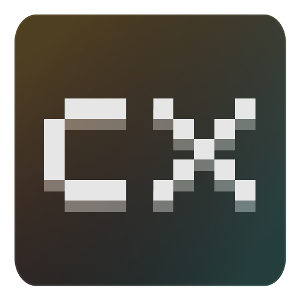

<div align="center">



# Chunkyxel Studio

**Tools and games where pixel art meets 3D.**

[chunkyxel.com](https://chunkyxel.com) · [info@chunkyxel.com](mailto:info@chunkyxel.com)

</div>

---

## About

Official website of **Chunkyxel Studio**, an independent team building tools and pixel art 3D games.

- **Tools:** [Chunkyxel](https://github.com/chunkyxel), a 3D modeling and pixel art editor with Godot and Unity integration.
- **Games:** Retro Collection (coming soon).

## Getting started

Requires Node.js 22.23.4 or newer.

```bash
./web.sh dev       # local dev server with hot reload
./web.sh build     # build to dist/ (git-ignored)
./web.sh preview   # build and serve the production output
```

